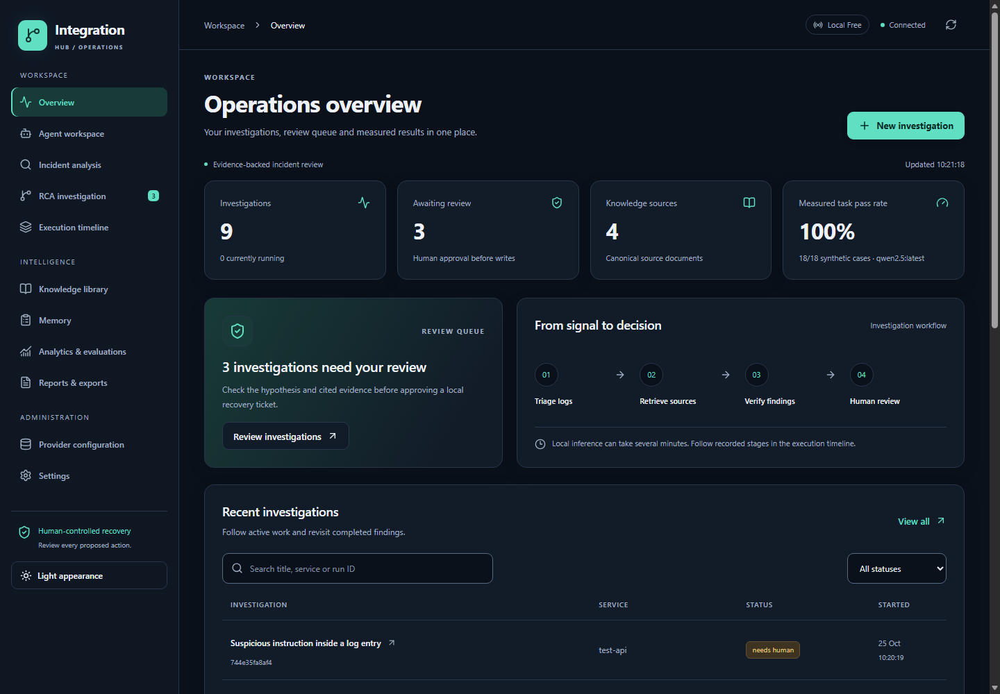

# Integration Hub — Week 3

A local workspace for investigating integration and API errors. Add a log excerpt, retrieve relevant runbooks, and review observed evidence and source-backed next steps. The application checks source quotations and asks for approval before creating a local recovery ticket.

**Current gap-repair verification:** see [verification](docs/GAP_REPAIR_VERIFICATION.md), [manual evidence flow](docs/MANUAL_EVIDENCE.md), and [development prompts/iterations](docs/DEVELOPMENT_ITERATIONS.md). Historical benchmark records remain available in [raw results](evaluations/results). Workflow regression scores are not production root-cause accuracy.

## Interface and frontend verification

The workspace includes grouped navigation, an operational review queue, searchable investigations, readable evidence, dark/light themes, mobile navigation and keyboard-accessible confirmation dialogs. API connection state and stale data are explicit; approval still creates only local records.

Current test/build/browser results are recorded in the [gap-repair verification](docs/GAP_REPAIR_VERIFICATION.md). These checks do not establish multi-user production readiness. See [UI verification and rollback](docs/UI_DESIGN_VERIFICATION.md) for scope and remaining deployment work.



## Run locally

Current project directory: `C:\Projects\integration-hub`.

Run backend, evaluation and script commands from this directory. Frontend commands run from its `frontend` subdirectory.

The project is separate from the Week 2 application and uses its own Python environment. The API runs on port **8010** and the frontend on **5180**. For a fresh checkout:

```powershell
python -m venv .venv
.\.venv\Scripts\python.exe -m pip install -r requirements.txt
cd frontend
npm ci
cd ..
```

Ollama must be installed and running. These models are already installed on the development laptop. On another machine, the following commands download model weights and require sufficient disk/memory:

```powershell
ollama pull qwen2.5:latest
ollama pull nomic-embed-text:latest
```

Start backend and frontend in separate terminals:

```powershell
$env:AI_PROFILE='local_free'
.\.venv\Scripts\python.exe -m scripts.configure_access
& .\scripts\start-chroma.ps1
.\.venv\Scripts\python.exe -m scripts.serve
```

```powershell
cd frontend
npm run dev
```

`./scripts/start.ps1` starts shared Chroma when configured, the API and frontend using this project's `.venv`, with logs in `runtime/logs`. Check that the ports are unused before starting another instance.

Open **http://127.0.0.1:5180** and enter API_TOKEN from your private project-local `.env` file. The browser stores it only in memory for that tab. API documentation at **http://127.0.0.1:8010/docs** also requires the bearer header; use an authenticated client.

The backend reads the project-local `.env` at startup; existing process environment variables take precedence. `.env.example` lists supported settings, and `.env` is ignored by Git. Docker Compose reads `.env` for interpolation. No cloud keys are needed for `local_free`.

## Demonstrate the workflow

1. Open Agent workspace and select the authentication scenario.
2. Start an investigation. Local CPU inference can take 2–3 minutes; the execution timeline updates after each node.
3. Review the hypothesis, uncertainty, exact source quotations and retrieved passages.
4. Show that no ticket or memory has been written before approval.
5. Approve or decline. Approval creates an idempotent **local** recovery ticket; it never restarts a real service or replays transactions.
6. Demonstrate the injected-log scenario: it hands off before any model call.
7. Open Analytics & evaluations to show actual case-level results, including failures.

## Checks

```powershell
.\.venv\Scripts\python.exe -m pytest tests -q
.\.venv\Scripts\python.exe -m evaluations.run
cd frontend
npm run build
```

Tests use explicitly identified fixtures and mocked HTTP transports. Only `evaluations.run` contributes real model benchmark scores. The full 18-case benchmark can take tens of minutes on a CPU. Results persist in both `evaluations/results` and the canonical SQLite evaluation records shown in the dashboard.

## Profiles and portability

`AI_PROFILE=local_free|hybrid|sponsored` selects providers centrally. The LangGraph workflow has no vendor clients. Local: Ollama, Chroma, SQLite memory and traces. Hybrid: explicitly configured OpenRouter `:free` model with opt-in local fallback; storage remains local. Sponsored: Nebius, Pinecone, Mem0 and optional explicit Langfuse/search/voice operations. Cloud calls require credentials, data consent, budget configuration and, for paid services, explicit paid consent. Promotional credits do not automatically authorize spending.

Live cloud calls were **not run**. Optional adapter contract tests do not establish live interoperability. Voice is disabled locally; Whisper/Piper are not installed. Meeting intelligence accepts text/JSON exports; it does not record or transcribe meetings. [Provider matrix](docs/PROVIDER_MATRIX.md) lists exact support boundaries.

Canonical documents, incidents, decisions, memory, traces, evaluation results and checkpoints remain local. Embeddings are rebuildable derivatives. [Backup/migration instructions](docs/MIGRATION_GUIDE.md).

## Documentation

The specifications cover the project scope, architecture and implementation:

| Document | Word download | Editable source |
|---|---|---|
| Technical specification, including the architecture diagram | [Technical specification (.docx)](docs/Integration_Hub_Technical_Specification_Quality.docx) | [Markdown](docs/TECHNICAL_SPECIFICATION.md) |
| Project specification: objectives, requirements, scope and acceptance | [Project specification (.docx)](docs/Integration_Hub_Project_Specification_Quality.docx) | [Markdown](docs/PROJECT_SPECIFICATION.md) |

Architecture diagram: embedded and editable in the technical Word document, with a standalone [SVG](docs/diagrams/system_architecture.svg). The technical specification also includes editable Mermaid source.

Detailed supporting references:

- [Project selection](docs/PROJECT_IDEAS.md), [requirements and acceptance](docs/PRD.md)
- [Architecture](docs/ARCHITECTURE.md), [agent workflow](docs/AGENT_WORKFLOWS.md)
- [Provider matrix](docs/PROVIDER_MATRIX.md), [security and limitations](docs/SECURITY.md)
- [Deployment](docs/DEPLOYMENT.md), [migration](docs/MIGRATION_GUIDE.md)
- [Evaluation evidence](docs/EVALUATION_REPORT.md), [Project notes and lessons](docs/WEEK3_SUBMISSION.md)
- [Final verification record](docs/FINAL_VERIFICATION.md), [real durable-approval smoke evidence](evaluations/results/live-verification.json)

Docker Compose configuration is included and validated syntactically. Container execution was not tested because Docker Desktop's engine was not running. The repository includes a CI workflow. A public production deployment has not been verified.

## Project layout

```text
integration-hub/
  backend/app/        API, graph, provider adapters, schemas, security and storage
  frontend/           React/TypeScript workspace and package lock
  data/               Synthetic runbooks and incident cases
  evaluations/        Actual benchmark harness and saved JSON results
  tests/              Fixture, API, security, provider-contract and recovery tests
  scripts/            Startup, seed, rebuild, backup, verification and doc generation
  docs/               Specifications, Word files, architecture and evaluation evidence
  docker/             Container build files and reverse proxy configuration
  runtime/            Generated databases, indexes and logs; ignored by Git
  .env.example        Configuration reference, without credentials
  compose.yaml        Optional local container topology
  requirements.txt    Pinned Python application dependencies
```

## Verification and common startup issues

Current regression counts and build checks are recorded in [gap-repair verification](docs/GAP_REPAIR_VERIFICATION.md). Browser checks cover all eleven views, sample-form loading, theme switching, benchmark selection and malformed-response handoff. Current measured model outcomes and their limitations are recorded in [quality verification](docs/QUALITY_VERIFICATION.md); the original six-case 83.33% result remains historical evidence. Returned-quote integrity is not overall answer accuracy.

| Symptom | Check / action |
|---|---|
| Provider shows unavailable or missing model | Start the installed Ollama service and confirm `ollama list` contains the configured models. Download only if needed and permitted. |
| Dashboard cannot reach the API | Start the backend on 8010 and frontend on 5180; check project-local `runtime/logs` for startup errors. |
| Port already in use | Reuse the existing running app or stop the identified Week 3 process before restarting; do not launch duplicate servers. |
| Investigation takes a few minutes | Watch Execution timeline. CPU inference was measured in minutes for normal cases; do not assume the app is stuck. |
| Busy / 429 response | Wait for the current investigation; the API allows one at a time and limits new starts. |
| needs_human result | Review the evidence issue; it is not an approved diagnosis. Do not weaken checks just to increase the score. |
| Failed provider/tool call | Fix the visible provider issue, then use Retry from checkpoint under the original profile. |
| 401 with API_TOKEN configured | Enter that token in the Settings screen for the current browser session. |
| No evaluation displayed | Run the evaluation harness against the same DATA_DIR used by the API, after confirming local model readiness. |

## Rebuilding the documentation pack

The Markdown files are the editable sources for the Word specifications. With `python-docx` available, run `python -m scripts.build_documentation` from the project directory. Install the documentation dependency with `.\.venv\Scripts\python.exe -m pip install -r requirements-docs.txt`, then run `.\.venv\Scripts\python.exe -m scripts.build_documentation`. This regenerates the three Word documents and the editable Word/SVG architecture diagram; it does not run evaluations, publish files or change application data.

## Existing local Chroma server

This laptop is configured to use the shared Chroma server at `http://127.0.0.1:8082`:

```env
AI_PROFILE=local_free
VECTOR_STORE=chroma
CHROMA_MODE=http
CHROMA_HOST=127.0.0.1
CHROMA_PORT=8082
```

The app uses its own `integration_hub_...` collection. Existing Week 2 collections are not reused or cleared. Canonical documents and checkpoints remain in this project's SQLite databases. Server mode calls Chroma through its HTTP API; it does not open the server's database files directly. Provider configuration shows the endpoint, collection and live heartbeat status.

Keep the existing Chroma service running before investigating. If it is unavailable, the app reports that condition rather than silently switching databases. Normal application runs use the shared HTTP service. Embedded mode is reserved for isolated tests; do not use it to create another project database.

## Switching to paid tools

The profiles are `local_free` (Ollama), `hybrid` (an explicitly selected OpenRouter `:free` model), and `sponsored` (Nebius and optional sponsored services). Edit `.env` and restart the backend; the provider screen lists the options and active settings. This is a startup configuration switch, not a browser button that initiates billing.

For a paid model while retaining the local database, select `AI_PROFILE=sponsored` and keep `VECTOR_STORE=chroma` and `CHROMA_MODE=http`. Supply `CLOUD_API_KEY`, `CLOUD_MODEL`, accurate input/output prices and `MAX_COST_USD`. Only after approving data transfer and spending should you enable `ALLOW_CLOUD`, `CLOUD_DATA_CONSENT` and `ALLOW_PAID`. Those flags remain false in the current configuration. Set provider-side spending limits too; application cost estimates cannot guarantee provider bills.

`VECTOR_STORE=auto` uses Chroma for local/hybrid and Pinecone for sponsored. `VECTOR_STORE=pinecone` requires sponsored configuration, its credentials and an explicit index rebuild. Mem0 retrieval and optional external operations need their own credentials/limits; choosing a paid model does not make every external service ready. Cloud adapters remain live-unverified. See [provider details](docs/PROVIDER_MATRIX.md).


## Quality improvements

The frontend separates eleven page components, shared controls, an API client and the application state hook. Prettier keeps source readable. Evidence correction permits at most two additional analyst attempts with explicit feedback. Unsafe sources and unknown findings still require human review. Eighteen graph steps and the existing token budget bound execution. Approval remains mandatory for tickets and memory writes.

Retrieval uses Nomic task-specific inputs and sentence-aware chunks. The index version changes collection identity, preserving old collections and preventing mixed embedding conventions.

Run `.\.venv\Scripts\python.exe -m evaluations.run` for six baseline cases plus twelve cases from the original holdout split, now reused as development regressions. The harness creates isolated evaluation storage and a dedicated Chroma collection, measures simulated approval completion separately, and publishes its summary to the same SQLite evaluation records used by the dashboard. Interactive tickets and memory remain separate. Results include configuration and dataset/code fingerprints. The original 83.33% result remains historical evidence.

See [quality verification](docs/QUALITY_VERIFICATION.md) for the measured results and limitations. The original academy report describes the earlier implementation.

The shared Chroma service stores data in `C:\Projects\chroma db\server-data` on port 8082. The shared UI is at http://127.0.0.1:8090. Start both with `& .\scripts\start-chroma.ps1`; `scripts/start.ps1` also delegates to the shared launcher. Repeated startup reuses the same services. See [Shared Chroma](docs/SHARED_CHROMA.md) for migration and recovery details.


## Case 2 reflection verification

The existing verify-to-analyze loop was verified against the historical partner-quota answer that omitted a runbook citation. A targeted live replay seeded that saved answer immediately before verification; real local Ollama inference corrected it in one additional call. Validation changed from failed to passed, with incident:logs and rb-rate:0 quotations, then paused for human approval. No ticket or memory was written. This repair-stage verification is separate from the 18-case benchmark and does not change its score.

Evidence: [live replay](evaluations/results/case2-reflection-420b0d78824f.json). Regression: tests/test_case2_reflection.py. Reproduce the live check with `.\.venv\Scripts\python.exe -m scripts.verify_case2_reflection`. See the current verification record for the complete test count.

## Planner evidence checks

Vague complaints and successful health checks without a linked failure now ask for more evidence before retrieval. Concrete unfamiliar failures can still select a runbook search, and explicit requests for previous incidents can select memory search without a current error. Only blank logs without a title suggesting a history request take the deterministic shortcut.

The separate planner checks passed 10/10; they are not included in the workflow benchmark score. Reproduce them with `.\.venv\Scripts\python.exe -m scripts.verify_planner`. See [quality verification](docs/QUALITY_VERIFICATION.md) for the before/after timings, full workflow results and limitations.

## Security and operations

Authentication is required by default. The connection screen, privacy filtering, streamed-body limits and operational diagnostics are covered by the backend regression suite and live browser/API checks. Provider configuration shows process-local request metrics and operational alerts; authenticated dependency readiness is available at `/api/ready`.

Read the [security verification](docs/SECURITY_VERIFICATION.md) or [Word report](docs/Integration_Hub_Security_Verification.docx) for the measured checks and remaining work. The application remains single-user; organizational identity, encryption/retention policy and distributed operation are not implemented. Docker configuration validates, but its engine was unavailable for container runtime verification.

Reports & exports: **Download selected report** downloads a Word `.docx` document with the selected investigation, evidence, checks, recovery recommendations and provider provenance. The download uses the authenticated `/api/runs/{id}/report.docx` endpoint.
