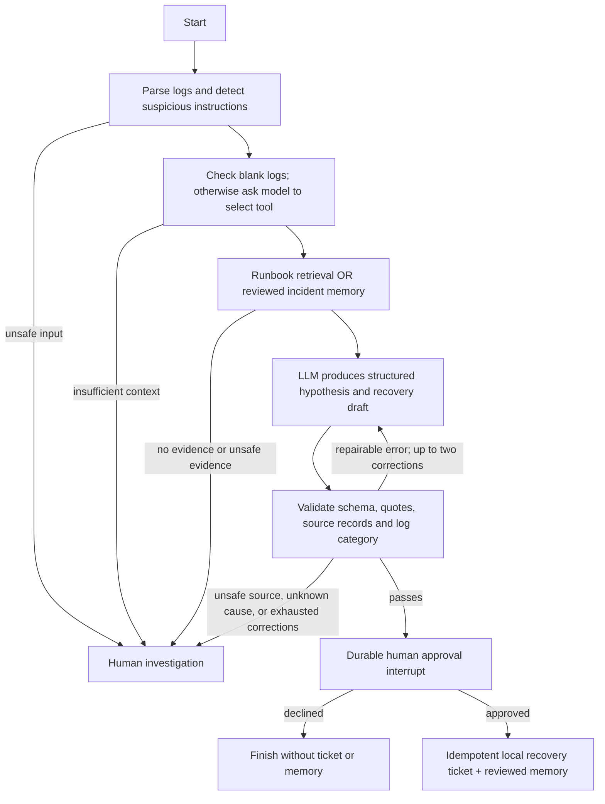

# Agent workflow

Shared state: run/tenant IDs, sanitized incident, parsed signals, planner decision, evidence passages, analyst output, citation verdict, provider/model usage, approval decision and ticket ID. It survives process restart through SQLite checkpoints. Cross-run memory is a separate SQLite record, populated only after approval and explicitly marked an unverified hypothesis.

Tools have fixed signatures. There is no arbitrary HTTP client, shell, SQL evaluator or user-supplied tool name available to the model. Unknown tool names fail Pydantic validation. The model's recovery text is never executed.

Each model call uses a strict JSON schema. The analyst is prompted to cite both the incident log and a retrieved document. Verification checks exact quote inclusion and canonical records, plus deterministic category/log consistency. These checks cannot prove semantic entailment; an operator reviews the hypothesis and uncertainty before approval.

Validation feedback and analysis attempt counts persist with the graph. Source integrity failures never enter the correction loop. Model start events expose the active stage before inference completes.

Provider failures receive at most one automatic retry. Transient failures can use a local LLM fallback only when explicitly configured; invalid credentials never trigger fallback. After three consecutive failed operations the adapter opens its circuit for 30 seconds. Graph failures persist and can resume from the saved node through the retry endpoint. Maximum graph steps and per-run token budget bound execution.

Approval side effects use stable IDs to avoid duplicate tickets when a node is replayed. The browser prompts for confirmation, and the server verifies an active interrupt before accepting a decision. Approval tests recreate the workflow object to demonstrate persistence across restart.

## Planner evidence boundaries

The planner asks for more information when the input contains only a vague complaint or a successful health check without a linked failure. A search query is required only when it chooses a search tool. The human-handoff message explains what evidence is missing.

Blank or whitespace-only logs skip the model unless the title suggests a request for previous incidents. This narrow shortcut does not use the recognized category list as a gate. An unfamiliar error, a connection reset, an application-level failure in an HTTP 200 response or an abnormal latency observation can still reach retrieval. Explicit requests for previous incidents can use memory without a current error.

The existing conditional edge routes request_human directly to handoff, with no retrieval or analyst call. Retrieval and analyst evidence checks, the bounded reflection loop and human approval remain in force. Tool-selection traces distinguish a model decision from the blank-log shortcut.

Separate boundary checks are reproducible with `python -m scripts.verify_planner`. They measure tool choice only and are not included in the full workflow benchmark score.
