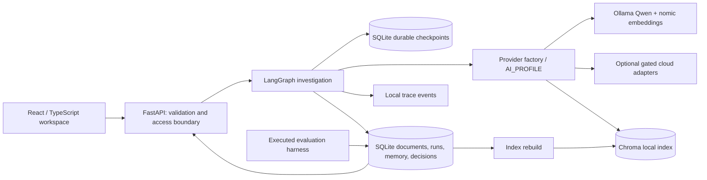

# Architecture

The repository is a modular single-service application, not a fleet of autonomous services. Two model-backed roles make meaningful decisions: a retrieval planner selects a tool/query and an analyst synthesizes a hypothesis. Deterministic graph nodes enforce the process around those decisions. This keeps the local runtime and evaluation tractable for one developer.

The application uses synchronous provider clients inside FastAPI's worker threads and background tasks. HTTP requests return a run ID; the UI polls state and traces every five seconds. One investigation at a time is admitted per process to protect a local CPU model. Use one backend worker. Production distributed queues and multi-worker locking are not implemented.

Each run has a tenant-scoped thread ID. Checkpoints persist graph transitions and human interrupts. Canonical records use `(kind, tenant, id)` keys. The browser has a fixed single-user identity and cannot select an arbitrary tenant. This is a data-isolation foundation, not a production multi-tenant identity system.

Chroma collections are keyed by tenant, embedding model and retrieval index version. Index metadata records dimension and document digest. The Pinecone adapter uses versioned namespaces and validates cloud matches against canonical documents. Changing an embedding model requires rebuilding an appropriate index; incompatible vectors are not silently reused.

The provider factory selects all implemented capabilities. Optional speech/web search are unavailable in the offline profile. Meeting processing is portable text/JSON ingestion. Cloud exports require explicit operator commands; agent nodes do not silently send traces or memory to outside services.

UI choices: custom accessible React components and CSS, Lucide icons and simple measured bar charts. Tailwind/shadcn/Recharts were not necessary for these screens. There are no runtime font/CDN dependencies. Theme and API-token session controls are local to the browser; the token is held in memory, not browser storage.

API references checked during implementation: [LangGraph interrupts](https://docs.langchain.com/oss/python/langgraph/interrupts), [Ollama chat](https://docs.ollama.com/api/chat), [Ollama embeddings](https://docs.ollama.com/api/embed), [Nebius API](https://api.tokenfactory.nebius.com/docs). Installed dependency versions were inspected locally rather than inferred from examples.
