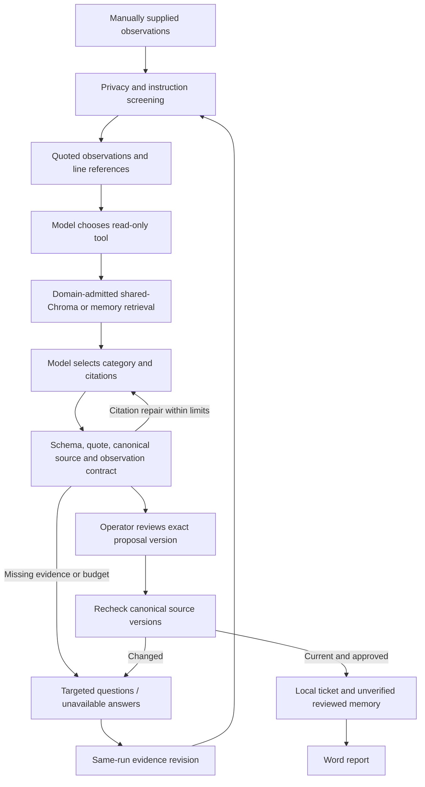

> Delivery status: targeted implementation is complete. Backend: 169 tests passed; frontend: 9 tests, build, lint and formatting passed; browser: 102 checks passed. At the final check, the existing live run `eval-2a846386b6a5` had completed 12/24 cases, all 12 passing. This is partial progress, not a final aggregate. No additional tests or assessments are being started. The existing process will publish its complete result to the dashboard when it finishes. No new academy score is asserted here.

# Gap repair verification

Date: 25 October 2026. Scope: targeted corrections to the independent 75/100 assessment. The original report remains the pre-repair baseline; it has not been rewritten to hide findings.

## Verified checks

| Check | Actual result | Boundary |
|---|---|---|
| Complete backend suite | 169 passed in 8.36 seconds | Temporary stores and explicit provider fixtures; not model accuracy |
| Frontend tests | 9 passed | API-client behavior |
| Production frontend build | Passed | TypeScript and Vite |
| Frontend lint and formatting | Passed | Includes both previously failing files |
| Browser verification | 102 checks passed; zero captured JavaScript errors | Real authenticated navigation, mocked browser action writes; manual evidence and approval digests included |
| Partial completion recovery | Passed | Simulated failure after ticket write resumes with one ticket and one memory record |
| Offline backup/restore | Passed | Canonical SQLite and paused LangGraph approval restored and completed; not a shared-Chroma disaster-recovery drill |
| First expanded live benchmark | 23/24 (95.83%) | `eval-408ec9d46f5e`; PBKDF2 case chose unrequested memory search; retained unchanged |
| Intermediate corrected run | Stopped after 8 recorded cases | `eval-75bb0e17e186`; partial evidence retained, no aggregate published |
| Final live benchmark | Running | `eval-2a846386b6a5`; same 24 cases, final frozen code |

Browser evidence: `runtime/gap-ui-verification/results.json`; screenshot: `runtime/gap-ui-verification/manual-evidence-desktop.png`. Reproduce the checks with the existing `scripts/verify_enterprise_ui.py`. Browser action fixtures do not create application records. Existing shared Chroma server/UI and ports remain unchanged. The Integration Hub API was restarted after verifying no active interactive investigation.

## Finding-by-finding disposition

| Audit gap | Targeted change | Verification | Remaining boundary |
|---|---|---|---|
| G01: unsupported cause with exact quotes passed | Accepted primary finding is an extractive observation summary; source-backed guidance replaces model-invented actions. Draft causal prose remains unverified. Scorer independently revalidates schema and observation contract. | Cooling-fan counterexample rejected; invented disable-authentication instruction cannot enter ticket | This intentionally does not claim autonomous semantic entailment or confirmed root cause |
| G02: real incident/domain mismatch | Added Oracle allocation and PBKDF2/authentication-workload guidance with official references; explicit domain admission before synthesis | Oracle allocation is not parsed as pool exhaustion; unrelated retrieval cannot reach analyst; six new operational-style cases | Corpus remains small; domain admission is not a calibrated semantic relevance model |
| G03: hidden prefix truncation / budget failure | Select diagnostic excerpts across the entire input; show selected-context boundary; reduce repair payload; budget reserve produces evidence-preserving handoff | Late 401 and PBKDF2 signals survive; no call occurs when reserve is insufficient | Conservative byte bound, not an exact tokenizer; all-line interpretation is not guaranteed |
| G04: no manual-evidence continuation | Same-run revisions, targeted questions, unavailable-answer input, previous snapshots, conflict/size/profile guards | API and browser tests cover revision increments, stale/duplicate submission and renewed review | Five revisions/12,000 total characters; no direct production-system access |
| G05: formatting gate failed | Formatted the affected frontend files and new component | Build, lint, tests, format check passed | Remote CI still depends on publishing the reviewed snapshot |
| G06: stale source approved | Source digests captured before pause; canonical records rechecked before completion; review digest binds UI/API approval | Changed/withdrawn sources block writes; stale client approval returns 409 | In-process local application; distributed transaction ownership not claimed |
| G07: failed draft looked authoritative | Prominent unverified banner, observed excerpts/line IDs, causal uncertainty, follow-up questions; Word includes evidence revision | 102 browser checks and report tests | Historical findings remain historical drafts; old results are not retroactively validated |
| G08: benchmark scope/freshness | Frozen source/corpus/dataset/environment/model digest manifest; deny publication if source data changes during execution; dynamic grounding/schema metrics; explicit not-measured diagnostic accuracy; dashboard freshness | Scorer adversarial regression and freshness tests; live run pending | New cases are authored regressions, not a blind independent holdout; expert usefulness review remains needed |
| G09: setup/docs/release drift | Updated stale port, documented shared-service prerequisite, configurable launcher root, genuine development-prompt appendix, measurable targets and retention semantics | Documentation/source review and full check suite | Final GitHub snapshot, accessible submission document and recording remain deliverables; no push or recording is claimed |
| G10: redaction damaged Basic Authentication prose | Context-sensitive Basic credential handling, retaining explicit header and Bearer protection | Positive credential tests and negative prose tests | Regex screening remains best-effort, not a DLP guarantee |

## Important design choice

A source quotation establishes that text was supplied; it does not establish that its causal interpretation is true. This repair chooses an honest, bounded evidence-review contract instead of adding another uncalibrated judge model or calling keyword overlap semantic verification. The LLM still chooses a tool, category and quotations, and performs citation repair. Accepted observations and next steps are constrained by evidence. Human review remains necessary for root-cause confirmation.

This improves safety and assessment credibility, but it must not be described as a measured improvement in real-world causal accuracy. No benchmark failures should be removed or expectations changed merely to regain 100%.

## Additional issue found by the expanded benchmark

The first full 24-case execution exposed a model choice that the original 18-case suite did not cover: `operational-pbkdf2` selected `search_memory` without a history request, found no evidence and safely handed off. That failed the declared task rubric. The stored 23/24 result is preserved, not relabelled.

`planning.enforce_tool_intent()` now enforces the existing tool policy in code. Memory search requires explicit history intent in the incident title. An unrequested memory choice is redirected to runbooks for concrete current failure signals, or to human handoff for vague input. It does not add model calls or change the expected answers. Seven regression checks cover valid history requests, concrete failures, vague evidence and instructions appearing only in log data.

The corrected full run starts with PBKDF2 to verify the failure early, and records the complete case order in its frozen manifest. No cases are omitted and no old responses are substituted. An intermediate run was stopped before publication after discovering a short Basic-credential JSON edge case. That issue and bare/unpadded credential variants are now covered by positive and negative tests. The independent validator also enforces the conservative confidence and uncertainty contract. Final run `eval-2a846386b6a5` continues on the frozen code; PBKDF2 passed again. See the delivery status above and the recorded final artifact when available.

## Current flow

## What was deliberately preserved

Provider adapters and cloud-consent controls, shared Chroma topology, eleven-page layout/themes, source/citation repair, durable checkpoints, approved local ticket mechanics, and the Word download route were retained. There was no dependency installation, remote deployment, Git push, production database connection, or change to ReguGraph. Existing pre-task uncommitted work was not reset.

Rollback snapshot of the initially targeted files: `runtime/gap-repair/backup.json` points to the dated directory. Preserve newly collected evidence before any manual rollback; the snapshot is not a database migration rollback.

## Remaining work toward an excellent submission

1. Independently review anonymized operational findings with an experienced integration engineer/DBA. Record acceptable hypotheses and forbidden claims before the next unseen evaluation.
2. Publish the tested source snapshot and verify a clean checkout against the separately provisioned shared service. Complete the required accessible document and recorded demonstration.
3. If moving beyond the local single-user scope, validate organizational identity, tenant authorization, durable concurrent job ownership, deployment networking, retention and full restore/load objectives. These are not claimed complete by local regression tests.

A revised provisional score will be assessed against the completed evidence, not assigned because 95/100 was requested. An official academy grade cannot be guaranteed.
