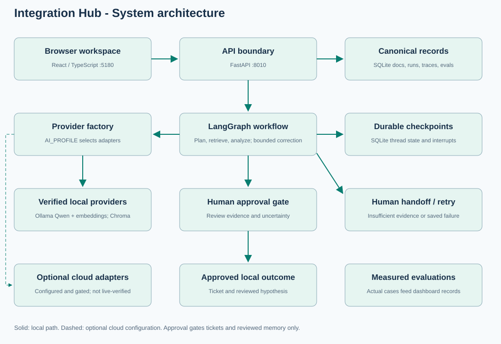
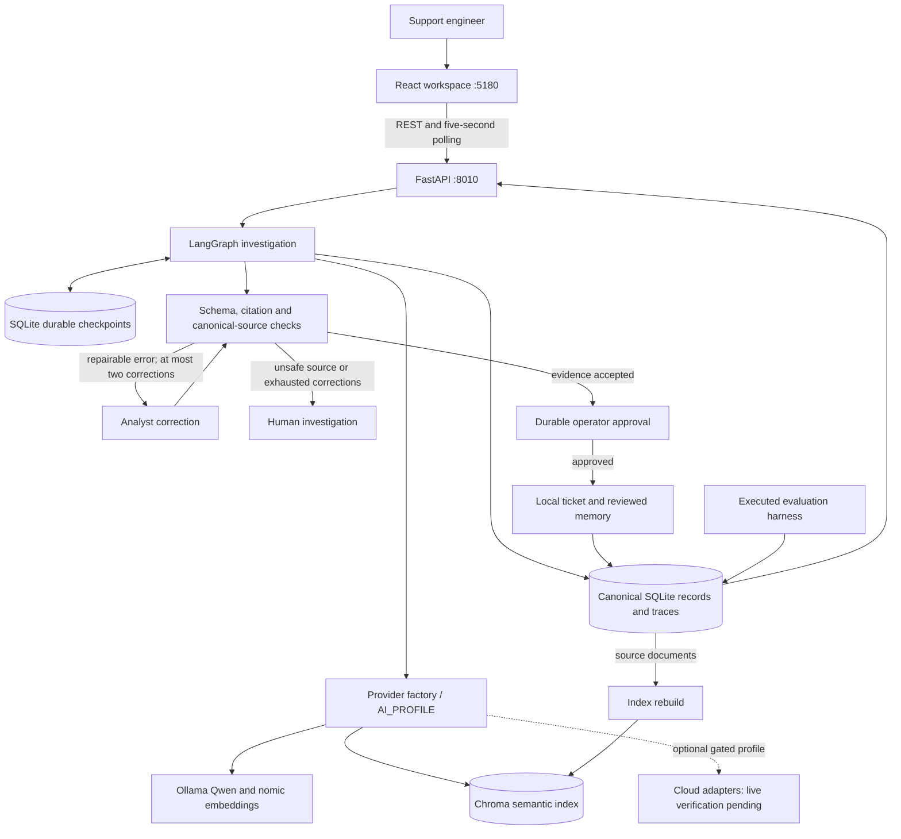

# Integration Hub
## Technical specification

Week 3 | Version 0.1.0 | Documentation baseline: 24 October 2026

Project directory: C:\Projects\integration-hub

This specification describes the revised application. Earlier six-case figures are retained as historical baselines; the current measured run and its limits are documented in QUALITY_VERIFICATION.md.

## 1. Technical purpose and boundaries

The application turns a sanitized integration log excerpt into a source-linked investigation and a proposed recovery plan. A model selects a permitted read-only tool; another model-backed role drafts a structured hypothesis. Deterministic code validates evidence and enforces a durable human-approval pause before a local recovery ticket and reviewed memory are written.

The current runtime is a local, single-user application. It does not restart production services, execute model-generated commands, replay transactions, send external messages, or establish that a proposed repair worked. The core runs without paid API calls after dependencies and model weights are installed.

## 2. System architecture



The diagram separates the verified local path from optional cloud adapters. Arrows indicate local application/data flows. The separate optional cloud box represents configuration-selected capabilities, not a tested live deployment. The Word diagram is fully editable; the standalone SVG shows the cloud branch with a dashed connection. Approval gates the ticket and reviewed-memory side effect; operational records and checkpoints are saved throughout execution.



## 3. Technology and component map

| Layer | Implementation | Responsibility |
|---|---|---|
| Browser | React 19, TypeScript 6, Vite 8, custom CSS, Lucide | Eleven screens, light/dark appearance, evidence review and confirmation |
| API | Python 3.12, FastAPI, Pydantic | Input validation, access boundary, admission control, background runs and exports |
| Orchestration | LangGraph 1.2.15 | Explicit state, conditional routing, node execution and interrupts |
| Checkpointing | langgraph-checkpoint-sqlite 3.1.0 | Durable graph transitions and resume after restart |
| Local reasoning | Ollama / qwen2.5:latest | Read-only tool selection and structured investigation synthesis |
| Local retrieval | nomic-embed-text:latest and Chroma 1.5.9 | Query/document embeddings and semantic passage retrieval |
| Canonical storage | SQLite | Documents, runs, decisions, memory, traces, tickets and evaluations |
| HTTP adapters | httpx 0.28.1 and provider protocols | Provider requests, errors, bounded retries and consent gates |
| Packaging | Native Python/npm; Docker Compose assets | Separate frontend/backend and persistent local data |

Exact Python pins are in requirements.txt; frontend resolution is recorded in frontend/package-lock.json. Custom CSS/components were used instead of adding shadcn/Recharts. The browser does not need remote fonts or a hosted asset CDN.

## 4. Agent workflow and state

| Stage | Execution | Output / transition |
|---|---|---|
| Triage | Deterministic parser and input checks | Error categories, HTTP codes, correlation IDs, timestamps; suspicious input hands off |
| Plan | Evidence-aware planner with a blank-log shortcut | search_runbooks for concrete failures; search_memory for explicit history requests; request_human for insufficient evidence. A query is needed only for retrieval. |
| Tools | Allowlisted provider call | Retrieved runbook passages or reviewed incident memory; empty results hand off |
| Analyze | Model-backed RCA analyst | Category, hypothesis, confidence, citations, checks, proposed recovery and uncertainty |
| Verify | Deterministic checks | Exact quotes, log/category consistency, log plus document evidence and canonical-record matching |
| Prepare / approval | LangGraph interrupt | Persisted awaiting_approval state with a concrete recovery proposal |
| Complete | Deterministic, approved write | Stable-ID local ticket and reviewed hypothesis; decline writes neither |

This is one stateful graph with two model-backed roles and supporting deterministic nodes, not seven independently deployed AI services. Models do not receive arbitrary shell or unrestricted network tools.

Shared state contains run and tenant identifiers, sanitized incident, parsed signals, planner decision, evidence, finding, validation, provider/model call metadata, approval decision, ticket ID, status and errors. The checkpoint thread ID is tenant-scoped. Cross-run memory is separate from graph checkpoints and is explicitly marked as a reviewed hypothesis, not a verified root cause.

## 5. Retrieval and evidence contracts

Canonical text is retained in SQLite. Documents prefer sentence and paragraph boundaries, with passages up to 1,000 characters and up to 100 characters of overlap. Long uninterrupted text uses bounded character windows. Source text is preserved exactly. Embeddings are generated locally. Nomic document and query inputs use search_document: and search_query: respectively; stored source passages remain unprefixed. Chroma collection identity includes tenant, embedding model and retrieval index version; index metadata records the document digest and vector dimension. Search returns up to three passages and refreshes a stale local index from canonical records.

The analyst schema permits the categories authentication, rate_limit, timeout, connection_pool and unknown. Citations carry a source ID and a verbatim quote of 8–500 characters. A normal accepted finding needs incident-log and retrieved-source evidence, category/log consistency, valid quotations and matching canonical records.

These checks establish source integrity, not semantic entailment. An exact quote can exist while a broader claim is unsupported. Confidence is model-generated and uncalibrated; it is not a probability. Human review remains part of the workflow.

The lexical evaluation baseline is simple token-overlap ranking, not BM25 and not the production planner's selected vector tool. Its measured speed is reported separately from the vector/embedding path.

## 6. API specification

Base URL: http://127.0.0.1:8010. Interactive API documentation: /docs. The frontend forwards /api to the backend.

| Method | Endpoint | Contract / behavior |
|---|---|---|
| GET | /api/health | Backend status, profile and version |
| GET | /api/config | Public settings and provider status; no credentials |
| GET | /api/dashboard | Runs, tickets, source count, memory count and persisted evaluations |
| POST | /api/runs | Validate incident; return 202 and run ID; execute in background |
| GET | /api/runs/{id} | Saved/live checkpoint state and trace events |
| POST | /api/runs/{id}/approval | Explicit boolean decision and optional note; reject invalid state |
| POST | /api/runs/{id}/retry | Resume failed/interrupted run; original profile required |
| GET / POST | /api/documents | List or add canonical text records |
| POST | /api/documents/upload | UTF-8 TXT, MD or JSON; maximum 50 KB |
| POST | /api/index/rebuild | Rebuild retrieval index while no investigation is active |
| GET / DELETE | /api/memory; /api/memory/{id} | List or explicitly forget reviewed memory |
| GET | /api/evaluations | Actual persisted benchmark records |
| GET | /api/runs/{id}/report | Plain-text Markdown report with provenance |
| GET | /api/samples | Synthetic example incidents |

Incident input: title 3–160 characters, service 1–80 characters, logs 3–12,000 characters. Document text submitted as JSON is 20–50,000 characters; upload limits are byte-based. Schemas reject extra fields. Common responses include 401 for missing authentication when configured, 403 for rejected browser origin, 404 for absent records, 409 for conflicting run state, 413/415/422 for invalid documents and 429 for admission/rate limits.

```json
{
  "title": "Customer API authentication failure",
  "service": "customer-api",
  "logs": "2026-10-24T08:00:00Z status=401 error=invalid_token message=token expired"
}
```

## 7. Storage, recovery and profile switching

| Asset | Location | Recovery strategy |
|---|---|---|
| Canonical records and trace events | runtime/hub.sqlite3 | SQLite snapshot and checksummed backup |
| Graph transitions and interrupts | runtime/checkpoints.sqlite3 | Preserve with canonical database; resume same thread |
| Derived vectors | runtime/chroma/ | Rebuild from canonical documents |
| Synthetic corpus | data/runbooks.json; data/incidents.json | Versioned project files |
| Benchmark artifacts | evaluations/results/ | Saved JSON; also persisted for dashboard consumption |
| Secrets | Process environment | Reconfigure separately; excluded from backup and source |

Stop the API and evaluations before cross-database backup. Restore requires an empty target and validates checksums and archive paths. Different embedding models/dimensions require compatible indexes and recomputation. Existing cloud-only records cannot be reconstructed unless exported/imported; local canonical copies remain usable when credits expire.

AI_PROFILE selects local_free, hybrid or sponsored centrally. Local uses Ollama/Chroma/SQLite. Hybrid uses an explicitly selected OpenRouter :free model with local storage and opt-in local LLM fallback. Sponsored selects Nebius, Pinecone and Mem0 adapters, with explicit Langfuse export, Keenable search and ElevenLabs speech operations. Local embeddings remain shared across profiles. Meeting support is text/JSON import, not recording/transcription.

## 8. Reliability and security

The graph allows at most 18 steps and uses a 10,000-token budget check with a conservative prompt-size estimate. Local model output is capped at 700 tokens per call; the configured HTTP timeout is 180 seconds. Provider operations receive at most one automatic retry; transient failures may use explicitly approved local LLM fallback. Authentication failures do not authorize fallback. Three consecutive failed operations open a 30-second circuit.

The API admits one active investigation per process and limits new runs to six per minute. Use one backend worker; locks/rate limits are process-local. Failed nodes save state for retry. Stable ticket IDs prevent duplicate local tickets on replay.

Controls include optional bearer authentication, fixed local browser identity, trusted hosts/origins, input limits, common-pattern secret/PII redaction, injection-pattern checks and deterministic tool authorization. Redaction and injection detection are not exhaustive. Cloud calls require explicit data/spending consent and configured budgets; conservative reservation estimates are not a replacement for provider-side hard limits.

## 9. Verification baseline and limitations

Saved verification: 30 Python tests passed; frontend production build and lint passed; API routes returned HTTP 200 through the frontend proxy. A real Qwen investigation resumed through a new workflow object and created one approved synthetic ticket. The saved benchmark is 5/6 tasks passed (83.33%); a missing runbook citation correctly led to human review.

Cloud adapters have mocked contract tests, not live interoperability evidence. Docker Compose syntax was validated but the container engine was stopped. Local audio/transcription is not implemented. Production deployment still needs organizational identity/RBAC, HTTPS, retention, encrypted storage/backups, operational review and broader human-labeled evaluations.

## 10. Implementation map

- backend/app/main.py: API routes, admission and browser access boundary.
- backend/app/workflow.py: state, nodes, prompts, evidence checks and approval.
- backend/app/providers.py: protocols, factory, local adapters and LLM fallback.
- backend/app/extensions.py: optional cloud service adapters and export boundary.
- backend/app/models.py, config.py, security.py, store.py: schemas, settings, sanitization and persistence.
- frontend/src/pages/, components/, hooks/useHub.tsx and lib/api.ts: screens, shared controls, state and API access. main.tsx mounts App.tsx; style.css defines presentation.
- evaluations/run.py: real benchmark and retrieval comparison.
- scripts/: startup, seeding, rebuild, backup, explicit external operations and real smoke verification.
- tests/: fixture/API/security/contract/backup verification; excluded from model-quality scores.

Related documents: ARCHITECTURE.md, AGENT_WORKFLOWS.md, PROVIDER_MATRIX.md, SECURITY.md, DEPLOYMENT.md, MIGRATION_GUIDE.md and FINAL_VERIFICATION.md.

## 11. Existing Chroma service connection

The current laptop configuration uses the project-owned Chroma server at http://127.0.0.1:8082 through the Chroma HttpClient. Its collection is named integration_hub_ followed by a tenant/model/index-version fingerprint. Other applications' collections are not used or cleared. The earlier benchmark used embedded Chroma; its timings are retained as historical measurements, not represented as a new HTTP benchmark.

CHROMA_MODE selects http or embedded; CHROMA_HOST and CHROMA_PORT set the local endpoint. VECTOR_STORE=chroma allows the same server to be used with the sponsored paid-model profile. VECTOR_STORE=auto preserves profile defaults. The project-local .env is loaded at startup with process environment precedence. Health status uses a real server heartbeat, and a connection failure does not silently change the storage backend.


## Current quality verification

18/18 task checks passed (100.0%). Simulated approval completion: 12/12 eligible cases (100.0%).

The current suite has 73 passing tests. Separate planner boundary checks passed 10/10; they measure tool selection only and are excluded from the workflow benchmark score. The six baseline and twelve original holdout cases now serve as development regressions after feedback-driven changes. They are not independent unseen validation. Evaluation storage and simulated approvals stay isolated. API and frontend-proxy dashboard responses match the complete saved result.

The planner requests missing evidence before retrieval, preserves searches for unfamiliar concrete failures and allows explicit requests for historical incidents. Model-correction feedback and approval state survive restarts. Earlier figures in this document are historical measurements. See QUALITY_VERIFICATION.md for complete evidence and limitations.
